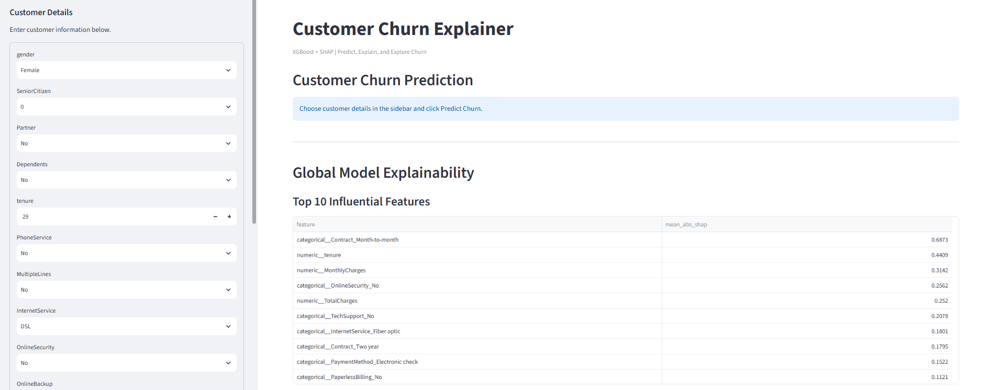
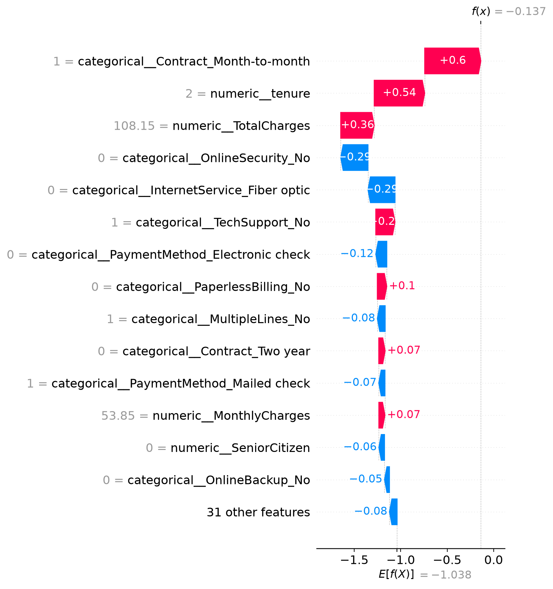
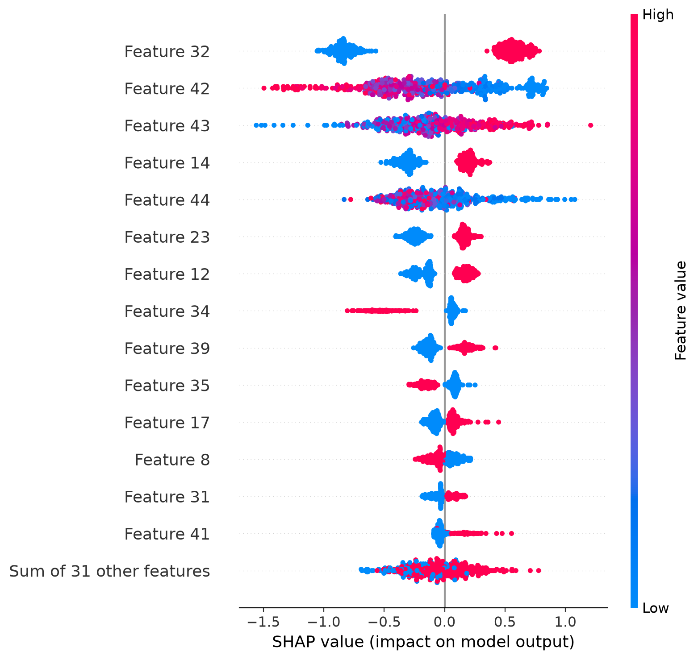
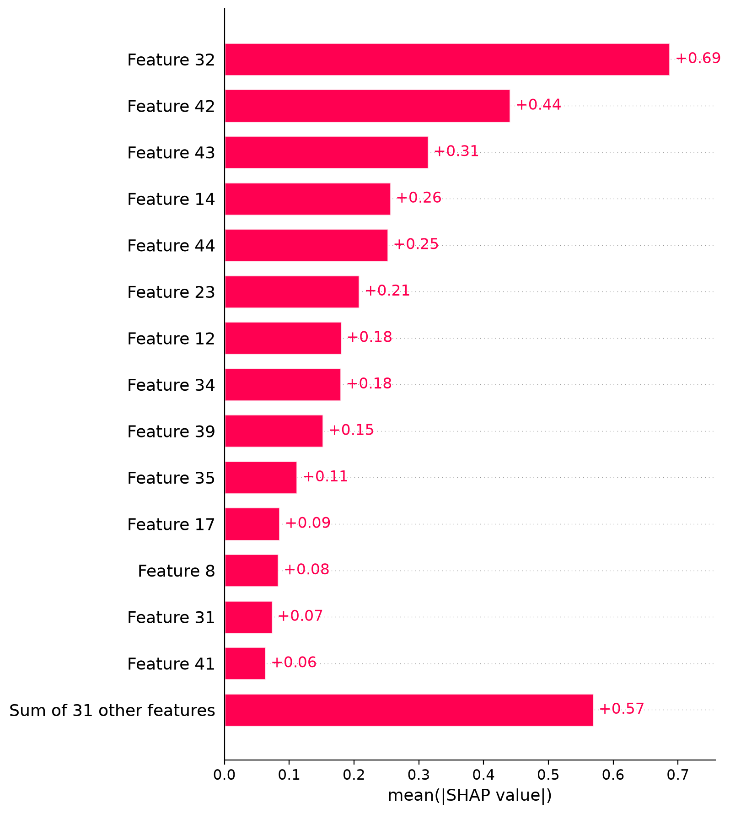
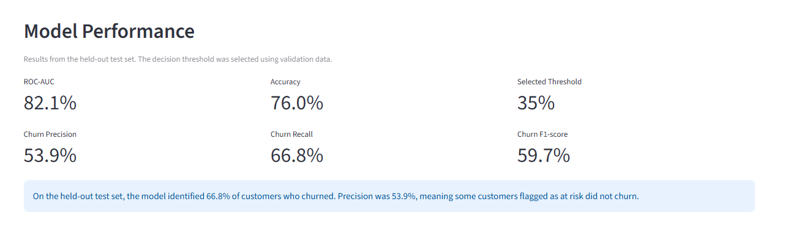
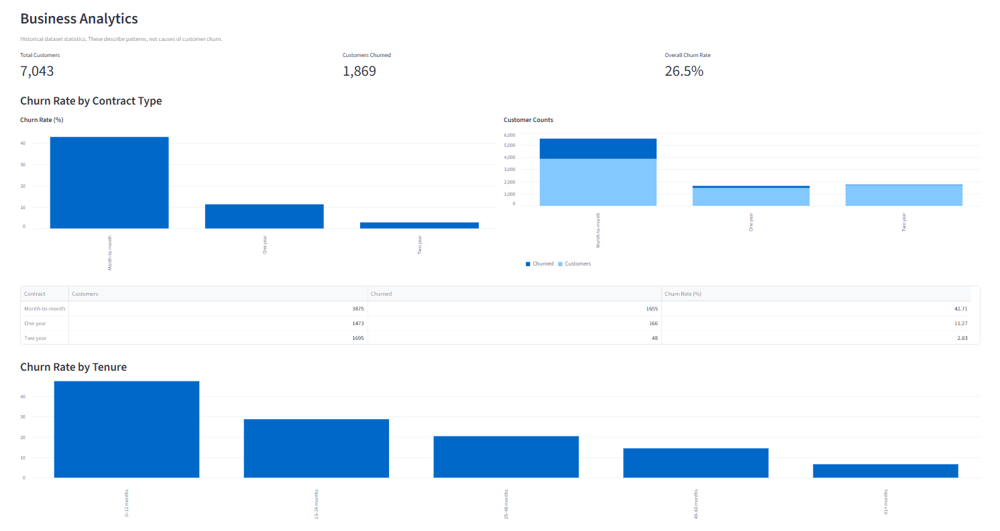

# Customer Churn Explainer using XGBoost and SHAP

An end-to-end machine learning project that predicts customer churn, explains individual predictions using SHAP, and provides business-focused customer retention recommendations through an interactive Streamlit dashboard.
## 🚀 Live Demo

[Launch Customer Churn Explainer](https://customer-churn-explainer-wtnptvop6brxfgxncvxzer.streamlit.app/)

Explore customer churn predictions, individual SHAP explanations, global feature importance, and business analytics through the interactive dashboard.
## 📸 Dashboard Preview







.png)
## Project Overview

Customer churn occurs when customers stop using a company's services. Identifying customers who may leave can help businesses prioritize customer support and retention efforts.

This project combines an XGBoost classification model with explainable AI techniques to estimate churn risk and make model predictions easier to interpret.

## Key Features

- **Customer Churn Prediction:** Estimate churn probability from customer attributes.
- **Explainable AI:** Use SHAP waterfall plots to explain individual predictions.
- **Global Feature Importance:** Identify features that influence model predictions across the dataset.
- **Model Evaluation:** Evaluate performance using ROC-AUC, accuracy, precision, recall, and F1-score.
- **Threshold Selection:** Select a classification threshold using validation data.
- **Retention Recommendations:** Generate rule-based suggestions based on customer profiles and predicted risk.
- **Business Analytics:** Explore churn patterns by contract type, tenure, and monthly charges.
- **Interactive Dashboard:** Enter customer details and explore predictions using Streamlit.

## Tech Stack

- Python
- Pandas and NumPy
- Scikit-learn
- XGBoost
- SHAP
- Matplotlib
- Streamlit
- Joblib

## Project Structure

```text
customer_churn_prediction/
├── app/
│   ├── check_setup.py
│   ├── check_data.py
│   ├── explore_data.py
│   ├── train_model.py
│   ├── evaluate_thresholds.py
│   ├── evaluate_model.py
│   ├── predict_churn.py
│   ├── test_prediction.py
│   ├── shap_global.py
│   ├── shap_local.py
│   └── streamlit_app.py
├── data/
│   └── Telco-Customer-Churn.csv
├── models/
│   └── churn_pipeline.joblib
├── outputs/
│   ├── shap_global_importance.csv
│   ├── shap_summary.png
│   ├── shap_bar.png
│   ├── selected_threshold.json
│   ├── validation_thresholds.csv
│   └── test_metrics.json
├── requirements.txt
└── README.md
```

## Model Performance

The model was evaluated on a held-out test set after selecting the decision threshold using validation data.

| Metric | Result |
|---|---:|
| ROC-AUC | 82.13% |
| Accuracy | 76.01% |
| Precision | 53.88% |
| Recall | 66.84% |
| F1-score | 59.67% |
| Selected threshold | 0.35 |

These results are from the current evaluation run and may change when the model or dataset split changes.

### What the metrics mean

- **ROC-AUC:** Measures how well the model ranks churners above non-churners across different thresholds.
- **Precision:** Of customers flagged as churn risks, the proportion who actually churned.
- **Recall:** Of customers who churned, the proportion identified by the model.
- **F1-score:** The harmonic mean of precision and recall.

At the selected threshold, the model identified approximately 66.84% of churners in the held-out test set. The predictions are estimates and should not be treated as guarantees.

## Explainable AI with SHAP

SHAP is used to explain the model at two levels:

**Global explanations**
- Rank features by their average absolute SHAP values.
- Explore feature importance across customers.
- Review SHAP summary plots.

**Local explanations**
- Inspect the factors that push an individual prediction higher or lower.
- Explore the model's reasoning for a particular customer.
- Support more transparent risk assessment.

SHAP explains model behavior, not causation. A feature associated with a high churn prediction does not prove that changing it will prevent churn.

## Installation

### 1. Clone the repository

```bash
git clone YOUR_GITHUB_REPOSITORY_URL
cd customer_churn_prediction
```

Replace `YOUR_GITHUB_REPOSITORY_URL` with your actual repository URL.

### 2. Create a virtual environment

Windows:

```powershell
python -m venv venv
.\venv\Scripts\Activate.ps1
```

### 3. Install dependencies

```bash
python -m pip install -r requirements.txt
```

### 4. Run the dashboard

```bash
python -m streamlit run app/streamlit_app.py
```

Streamlit will display a local URL in the terminal. Open that URL in your browser.

## How to Use

1. Start the Streamlit application.
2. Enter customer information in the sidebar.
3. Select the churn decision threshold.
4. Click **Predict Churn**.
5. Review the predicted probability and classification.
6. Explore the local SHAP explanation.
7. Review global feature importance and model metrics.
8. Examine the retention recommendations and business analytics.

## Limitations

- Model performance depends on the quality and representativeness of the dataset.
- Churn predictions may include false positives and false negatives.
- The selected threshold reflects a validation-based optimization choice and may not match every business's costs.
- Retention recommendations are heuristic rules, not experimentally validated interventions.
- The analysis describes historical patterns and does not establish causal relationships.

## Future Improvements

- Add a confusion matrix and precision-recall curve to the dashboard.
- Add batch predictions for multiple customers.
- Deploy the application online.
- Add monitoring for changes in data and model performance.
- Evaluate retention strategies using controlled experiments.

## Disclaimer

This project is intended for educational and portfolio demonstration purposes. Predictions should support, not replace, appropriate business judgment.
